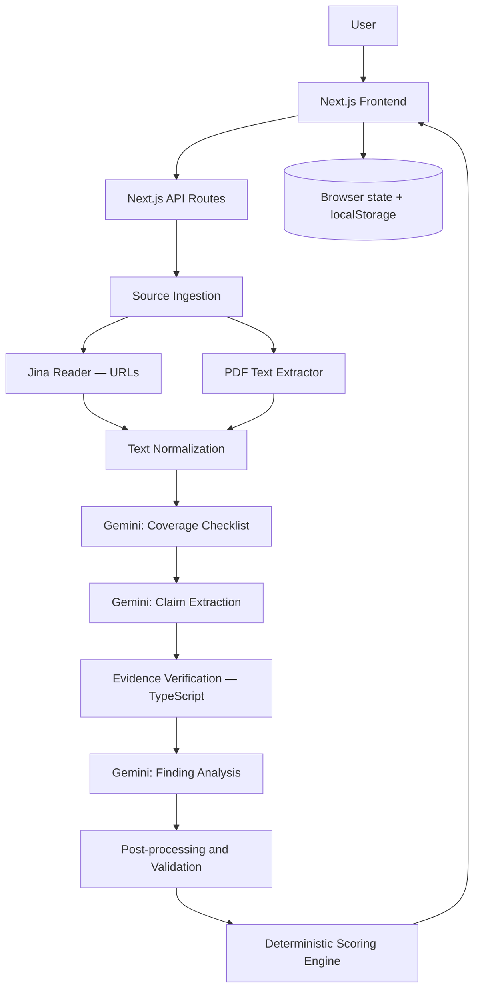
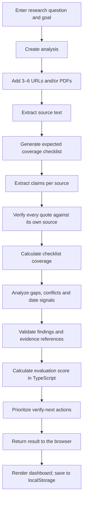

# Blunder Check — System Architecture

> **Project:** Blunder Check  
> **Hackathon:** Shinchan Online Hackathon 2026 — Digital Dark Spot  
> **Architecture version:** 1.1 (MongoDB removed; staged client-orchestrated pipeline)  
> **Status:** MVP architecture  
> **Primary goal:** Analyze multiple sources for a research goal, expose evidence gaps and conflicts, and recommend what the user should verify next.

> **v1.1 changes (read first):** no database (state in the browser + static demo JSON); the pipeline is **staged** (one small API route per stage, orchestrated by the client) to stay inside serverless time limits; Gemini call 3 **cites claim ids** instead of re-quoting, and code attaches the quotes; added a paste-text source type and cached demo mode. Shapes live in `schemas/` and routes in `docs/CONTRACTS.md`.

---

## 1. Product overview

Blunder Check treats research like chess analysis.

The user supplies a research question and several sources. The platform builds an expected-coverage checklist, extracts claims with source quotations, checks the evidence, identifies potential information gaps and conflicts, and produces a prioritized verification plan.

Chess terminology is the product's presentation metaphor:

| Chess concept | Blunder Check meaning |
|---|---|
| Evaluation score / eval bar | Evidence-completeness assessment of the reviewed sources |
| Blunder | Potentially consequential conflict or outdated information |
| Missed move | An expected research question not adequately addressed by reviewed sources |
| Hanging piece | A high-impact unresolved or weakly supported item |
| Best move | The next verification action, prioritized by impact |
| Blunder replay | How the assessment changes when evidence is reviewed or corrected |

**Important:** The evaluation score is not a probability that a decision is safe, nor a guarantee that the underlying information is true. It is an explainable indicator derived from the evidence reviewed by the application.

---

## 2. Architecture principles

1. **Evidence before explanation:** Every finding should reference the source evidence that supports it.
2. **AI proposes; code verifies:** Gemini may propose claims and findings, but TypeScript validates schemas, quote matches, source references, coverage and scoring.
3. **No unsupported certainty:** Findings are potential signals, not guaranteed facts.
4. **Absence is scoped:** “Not found in reviewed sources” must never be presented as “does not exist.”
5. **Dates must be evidenced:** Flag information as potentially outdated only when a relevant date or cycle is visible in the source.
6. **Keep the MVP simple:** One Next.js full-stack application; no microservices, separate Python backend, vector database or authentication requirement.
7. **No database for the MVP:** analyses live in browser state and `localStorage`; demo cases are static JSON in `public/demo/`. Fewer moving parts, nothing to break on demo day.

---

## 3. High-level system architecture



### Main layers

| Layer | Responsibility |
|---|---|
| Frontend | Research input, source upload, progress, findings, evidence viewer |
| API layer | Validate requests, orchestrate processing, handle persistence |
| Source ingestion | Fetch URLs, parse PDFs, normalize extracted text |
| Gemini pipeline | Generate checklist, extract claims, propose findings |
| Verification engine | Verify quotations and references; calculate coverage |
| Scoring engine | Calculate explainable information-position score |
| Browser state | Holds sources, claims and the final analysis (`localStorage`, last 5) |

---

## 4. End-to-end analysis workflow



### Pipeline stages

#### Stage 1 — Source ingestion
- Accept user-provided URLs and PDF files.
- Fetch web text through Jina Reader.
- Extract PDF text server-side.
- Normalize whitespace while preserving the original extracted text.
- Keep extracted text in client state, subject to `LIMITS.MAX_SOURCE_CHARS` (truncate and mark `truncated`).
- Pasted text is a first-class source type (fallback for blocked pages and scanned PDFs).
- Record extraction failures rather than silently ignoring sources.

#### Stage 2 — Expected coverage checklist
Input: research topic and user goal.

Output: checklist items with stable IDs, descriptions and importance (`high`, `medium`, `low`).

The checklist describes what a sufficiently complete answer would need to address. It is a proposed research framework, not proof that every item is universally necessary.

#### Stage 3 — Claim extraction
For each source, Gemini returns structured claims:
- checklist item association, if applicable;
- concise claim;
- exact supporting quotation;
- visible date or cycle, if present;
- source identifier.

Claims that cannot be associated with a checklist item may be retained as additional observations if useful.

#### Stage 4 — Evidence verification
Run in application code:
- Validate AI output with Zod.
- Match each quotation against the text of its cited source.
- Normalize whitespace for matching, without changing the stored original text.
- Store match status and character offsets where possible.
- Reject or flag unmatched quotations.
- Never allow a quote from one source to validate against another source.
- Remember: a matching quotation proves text presence, not that the quotation logically supports the AI interpretation.

#### Stage 5 — Coverage and finding analysis
Calculate coverage from verified claims mapped to checklist items.

Distinguish:
- **Missing:** No reviewed source addresses the checklist item.
- **Unanswered:** Sources mention the subject, but do not establish the requested detail.
- **Conflict:** Reviewed sources provide incompatible claims.
- **Potentially outdated:** A relevant older date/cycle is visible and a newer applicable source or cycle makes it relevant to flag.
- **Unknown:** Evidence is insufficient to classify confidently.

All findings must carry source references and verified quotations where applicable. A genuine gap may have no supporting quote; instead, show the checklist item and the reviewed-source scope used to identify it.

#### Stage 6 — Evaluation score
Calculate the score deterministically in TypeScript from documented signals, such as:
- importance-weighted checklist coverage;
- unresolved high-impact items;
- conflicts;
- evidenced stale-cycle warnings;
- verified current evidence.

Gemini may provide a natural-language explanation, but must not choose the final score.

The score should be labelled **Information Position**, not “probability of safety.” Show the reasons behind score changes. Keep the scoring formula versioned and documented so results are reproducible.

#### Stage 7 — Verify-next recommendations
Generate a prioritized list of concrete verification actions:
- what to verify;
- why it matters;
- where to verify it;
- which finding/checklist item triggered it.

Prioritize by impact and uncertainty, not merely by the order returned by the model.

---

## 5. Frontend architecture

### Main screens

1. **Research setup**
   - Research question and goal
   - URL entry
   - PDF upload
   - Source list and extraction status
   - Start analysis action

2. **Analysis dashboard**
   - Information Position and evaluation bar
   - Coverage overview
   - Blunders
   - Missed moves
   - Hanging pieces
   - Best moves / verify-next checklist
   - Clear evidence-status labels

3. **Evidence viewer**
   - Selected source and metadata
   - Extracted source text
   - Highlighted matched quotation
   - Quote verification status
   - Link to original URL when available

### Suggested component tree

```text
components/
├── layout/
│   ├── Navbar.tsx
│   └── AppShell.tsx
├── research/
│   ├── ResearchInput.tsx
│   ├── URLInput.tsx
│   ├── PDFUploader.tsx
│   └── SourceList.tsx
├── chess/
│   ├── EvaluationBar.tsx
│   ├── EvaluationScore.tsx
│   ├── BlunderCard.tsx
│   ├── MissedMoveCard.tsx
│   ├── HangingPieceCard.tsx
│   └── BestMoveList.tsx
├── evidence/
│   ├── SourceViewer.tsx
│   ├── QuoteHighlight.tsx
│   ├── VerificationBadge.tsx
│   └── EvidenceStatus.tsx
└── analysis/
    ├── AnalysisLoader.tsx
    ├── CoverageOverview.tsx
    └── FindingsPanel.tsx
```

### Evidence labels

Use consistent labels everywhere:
- **Sourced** — directly supported by a verified source quotation.
- **AI-inferred** — interpretation or potential signal proposed by AI.
- **Unknown** — not established by reviewed evidence.

Do not use color alone; include text labels and accessible contrast.

---

## 6. Backend API design

Staged routes, orchestrated by the client (`lib/pipeline.ts`). Each route is small, validated with Zod, and sets `maxDuration = 60`.

| Method | Endpoint | Purpose |
|---|---|---|
| `POST` | `/api/ingest/url` | Fetch one URL via Jina Reader → `SourceRecord` |
| `POST` | `/api/ingest/pdf` | Parse one PDF (multipart) → `SourceRecord` |
| `POST` | `/api/checklist` | Gemini call 1: expected-coverage checklist |
| `POST` | `/api/extract` | Gemini call 2 for ONE source + quote verification |
| `POST` | `/api/analyze` | Gemini call 3 + reconcile + deterministic score |

Pasted text needs no route. Full request/response shapes, error codes and rules: **`docs/CONTRACTS.md`**.

All endpoints must validate input, enforce source/file/text limits, handle provider errors and avoid exposing secrets to the browser.

---

## 7. AI pipeline contracts

Use three structured Gemini calls, with Zod validation after every response.

### Call 1 — `coverage_checklist`
Input:
- research topic;
- user goal.

Output concept:

```ts
type ChecklistItem = {
  id: string;
  item: string;
  importance: "high" | "medium" | "low";
};
```

### Call 2 — `extract_claims`
Input:
- one source's extracted text;
- checklist.

Output concept:

```ts
type ExtractedClaim = {
  checklistId: string | null;
  claim: string;
  quote: string;
  visibleDate: string | null;
};
```

The server attaches the trusted `sourceId`; do not trust a model-generated source identifier.

### Call 3 — `analyze`
Input:
- checklist;
- verified claims;
- source metadata and visible dates.

Output concept:

```ts
type ProposedAnalysis = {
  evalReasoning: string;
  blunders: Array<{
    type: "conflict" | "outdated";
    description: string;
    checklistId: string | null;
    severity: "high" | "medium" | "low";
    claimIds: string[]; // ids of verified claims; code resolves the quotes
  }>;
  missedMoves: Array<{
    checklistId: string;
    description: string;
    whyItMatters: string;
  }>;
  hangingPieces: Array<{
    description: string;
    impact: "high" | "medium" | "low";
    checklistId: string | null;
  }>;
  verifyNext: Array<{
    priority: "high" | "medium" | "low";
    action: string;
    reason: string;
    whereToVerify: string;
  }>;
};
```

**v1.1:** the model cites server-assigned claim ids only (never re-types quotes); `lib/reconcile.ts` resolves quotes, enforces the rules in `docs/CONTRACTS.md` §6, and adds automatic findings for gaps the model missed. The final evaluation score is calculated by the application, not accepted from model output.

---

## 8. Data model (no database)

Shapes are defined as Zod schemas in `schemas/` (`Analysis`, `SourceRecord`, `VerifiedClaim`, `AnalyzeResult`, ...). An `Analysis` is a plain JSON object held in React state, saved to `localStorage` (key `blunderCheck.analyses.v1`, last 5) and, for demos, loaded from `public/demo/<case>/analysis.*.json`.

```text
Analysis
├── question, goal, mode ("live" | "demo_cached")
├── checklist[]            ChecklistItem
├── sources[]              SourceRecord (text, status, dateSignals)
├── claims[]               VerifiedClaim (server ids, quote verification offsets)
└── result                 AnalyzeResult
    ├── coverage[]         checklist item + status (covered|conflicted|unanswered|missing)
    ├── blunders[]  missedMoves[]  hangingPieces[]  verifyNext[]
    ├── score              Information Position + factors + cap
    └── warnings[], scopeNote, disclaimer
```

If persistence/history is wanted later, a single `analyses` collection holding this JSON is enough. It is deliberately out of scope for the MVP.

---

## 9. Suggested repository structure

```text
blunder-check/
├── AGENTS.md  CLAUDE.md  GEMINI.md        agent rules (single source: AGENTS.md)
├── docs/                                   ARCHITECTURE, CONTRACTS, SCORING_SPEC, PROMPTS, UI_SPEC, DEMO_CASES, TASKS, SUBMISSION_TEMPLATE
├── app/
│   ├── api/{checklist,extract,analyze}/route.ts
│   ├── api/ingest/{url,pdf}/route.ts
│   ├── page.tsx  layout.tsx  globals.css
├── components/{layout,research,chess,evidence,analysis}/
├── lib/
│   ├── gemini.ts  jina.ts  pdf.ts  text.ts  prompts.ts  pipeline.ts      (to build)
│   ├── verification.ts  scoring.ts  reconcile.ts                          (provided + tested)
│   └── __tests__/
├── schemas/{limits,coverage.schema,claims.schema,analysis.schema,index}.ts
├── types/index.ts
├── scripts/{build-mock,snapshot-demo,smoke,gemini-smoke}.ts
├── public/demo/{scholarship,hostel,real-1}/
├── vitest.config.ts  .env.example  .gitignore  package.json
```

---

## 10. Environment variables

```env
GEMINI_API_KEY=
GEMINI_MODEL=gemini-2.5-flash   # verify the current model id in Google AI Studio
JINA_API_KEY=                    # optional
```

Keep all secrets server-side. Commit `.env.example`, never `.env.local`.

---

## 11. Security, reliability and limitations

- Validate URL protocols and reject unsupported schemes; protect URL fetching against SSRF and private/internal network targets.
- Apply file-size, extracted-text, source-count and request-time limits.
- Treat fetched webpages and PDFs as untrusted data, not as instructions to the AI.
- Do not render raw source HTML.
- Validate every AI response with Zod and handle malformed or incomplete output.
- Verify quotations against the exact source from which they were extracted.
- A verified quotation establishes text presence, not truth or entailment.
- Do not infer publication dates when none are visible.
- Show source-fetch failures and partial analyses explicitly.
- Display the disclaimer: **“Based on reviewed sources only. Absence in these sources does not mean absence in reality.”**
- No accounts and no server-side storage of analyses, so there is nothing to leak between users. Apply basic request-size limits; rate limiting is out of scope for the hackathon, but keep API keys server-side and avoid logging source text.
- Do not promise that the score establishes whether a real-world decision is safe.

---

## 12. MVP build priorities

### P0 — Required for a credible working prototype
- Research question and goal input
- URL and PDF ingestion
- Source extraction
- Expected coverage checklist
- Claim extraction with quotations
- Programmatic quote verification
- Gap, conflict and evidenced staleness signals
- Deterministic evaluation score
- Verify-next checklist
- Evidence-linked findings

### P1 — Polish and demo reliability
- Chess-style dashboard
- Evaluation bar animation
- Click finding to open source evidence
- Highlight verified quotations
- Sourced / AI-inferred / Unknown labels
- Two preloaded demo cases
- Clear loading, error and partial-result states

### P2 — Only after P0 and P1 are stable
- Blunder Replay
- Adversarial “Opponent Mode”
- More advanced source-provenance analysis
- Optional source-reputation signals

---

## 13. Two-minute judge demo

1. Enter a concrete research goal, such as checking a scholarship application.
2. Add three or four prepared sources.
3. Show the generated expected-coverage checklist.
4. Run analysis and show the Information Position.
5. Open a conflict/blunder and inspect both source quotations.
6. Show that quotations are programmatically verified.
7. Open a missed move to show what the reviewed sources did not establish.
8. Finish with the prioritized verify-next checklist and the visible limitation disclaimer.

The demo should use real or clearly labelled sample sources. Never present fabricated analysis as real-world evidence.

---

## 14. Architecture decisions for the MVP

| Decision | MVP choice |
|---|---|
| Application | Next.js full-stack |
| Language | TypeScript |
| Database | None (browser state + localStorage; static demo JSON) |
| AI | Gemini structured JSON output |
| URL extraction | Jina Reader |
| PDF extraction | Server-side parser |
| Validation | Zod (schemas in `schemas/`) |
| Authentication | None initially |
| File storage | None; PDFs parsed in memory, text kept in client state |
| Processing | Staged: one small route per stage, orchestrated by the client |
| Deployment | Vercel |
| Evaluation | Deterministic TypeScript scoring |

**Build principle:** Complete one end-to-end analysis reliably before adding optional features.
